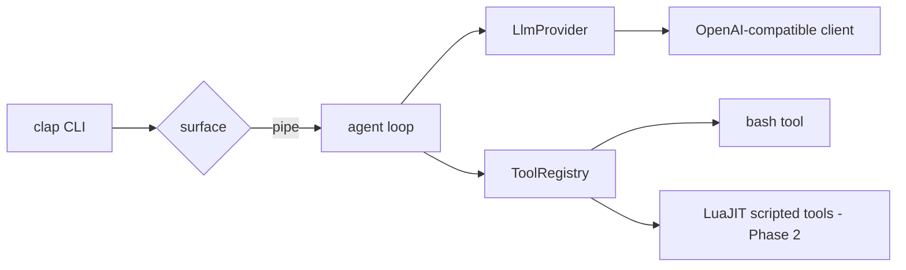

# sigil

**A Rust + LuaJIT coding agent with a self-evolving harness.**

One binary. Bring any model. The harness evolves itself.

```bash
echo "fix the bug in src/main.rs" | sigil
```

sigil is a terminal coding agent built from scratch in Rust. It speaks the
OpenAI-compatible chat API, so vLLM, Ollama, llama.cpp, DeepSeek, and every
OpenAI-compatible endpoint work out of the box. The long-term vision is a
**self-evolving harness**: LuaJIT embedded in the binary as the evolution
engine, so the agent can grow its own capabilities at runtime.

> Status: **Phase 0** — minimal agent loop (provider + ReAct + bash tool).
> Pipe mode works today; LuaJIT evolution lands in Phase 2.

## Quick start

```bash
# Build
cargo build --release

# Run (env-var configuration)
SIGIL_MODEL=deepseek-v4-flash \
SIGIL_BASE_URL=http://10.10.10.115:8010/v1 \
echo "what files are in this repo?" | ./target/release/sigil
```

### Configuration

| Env var | Default | Purpose |
|---------|---------|---------|
| `SIGIL_MODEL` | `deepseek-v4-flash` | Model name |
| `SIGIL_BASE_URL` | `http://10.10.10.115:8010/v1` | OpenAI-compatible endpoint |
| `SIGIL_API_KEY` | `EMPTY` | API key (bearer token) |

CLI flags override env vars: `--model`, `--base-url`, `--api-key`,
`--max-steps` (tool-call budget per turn, `0` = unlimited), `-p/--prompt`.

## How it works

```
stdin prompt ──► agent loop ──► LlmProvider (OpenAI-compatible stream)
                    │  ▲
                    ▼  │
              ToolRegistry (bash, ...) ◄── model tool calls
```

- **`llm::LlmProvider`** — the provider contract. Every backend implements it,
  so the agent loop stays provider-agnostic. `OpenAiProvider` works against
  vLLM / Ollama / llama.cpp `/v1` / DeepSeek and any compatible endpoint.
- **`agent::run_turn`** — the ReAct loop: stream completion → parse tool call
  → execute → repeat until the model stops (or `max_steps`).
- **`tools::ToolRegistry`** — native tools behind one lookup. The model calls
  tools by emitting a fenced JSON block (Phase-0 convention; native
  function-calling delta accumulation lands in Phase 1).

## Roadmap

| Phase | Scope |
|-------|-------|
| **0** ✅ | Scaffold, `LlmProvider`, minimal ReAct loop, bash tool, pipe mode |
| **1** | Native tool-call streaming, file/git tools, approval gate, config file |
| **2** 🔮 | **Embedded LuaJIT (`mlua` vendored) + FFI tool surface — self-evolution** |
| **3** | Evolve harness bundle + AHE loop + safety (activegate / circuit breaker) |
| **4** | MCP (client + serve), ACP, memory, subagents |

## Architecture



## Development

Rust 2024, single binary. `tokio`, `reqwest` (rustls — no OpenSSL link
dependency), `clap`, `serde`.

```bash
cargo fmt -- --check
cargo clippy --all-targets -- -D warnings
cargo test
```

## License

MIT. See [LICENSE](LICENSE). Copyright (c) 2026 alitrack.

中文版说明见 [README_cn.md](README_cn.md).
