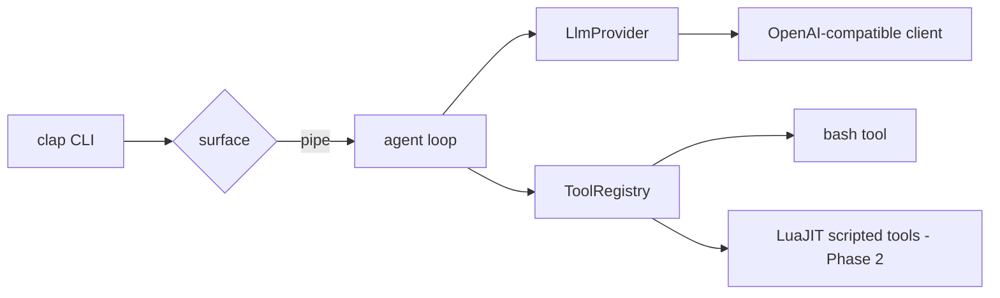

# sigil

**一个 Rust + LuaJIT 的 coding agent，带自进化 harness。**

单二进制。任意模型。harness 自我进化。

```bash
echo "修复 src/main.rs 里的 bug" | sigil
```

sigil 是用 Rust 从零开发的终端 coding agent。它说 OpenAI 兼容的 chat API，
所以 vLLM、Ollama、llama.cpp、DeepSeek 和任意 OpenAI 兼容端点开箱即用。
长期愿景是**自进化 harness**：把 LuaJIT 嵌入二进制作为进化引擎，让 agent
在运行时自我成长能力。

> 状态：**Phase 0** — 最小 agent 循环（provider + ReAct + bash 工具）。
> 今天即可用管道模式；LuaJIT 进化在 Phase 2 落地。

## 快速开始

```bash
# 构建
cargo build --release

# 运行（环境变量配置；默认走 cc-switch 代理 + deepseek-v4-flash）
echo "这个仓库里有哪些文件？" | ./target/release/sigil
```

### 配置

| 环境变量 | 默认值 | 用途 |
|---------|--------|------|
| `SIGIL_MODEL` | `deepseek-v4-flash` | 模型名 |
| `SIGIL_BASE_URL` | `http://127.0.0.1:15722/v1` | OpenAI 兼容端点（cc-switch 本地代理） |
| `SIGIL_API_KEY` | `EMPTY` | API key（bearer token） |

任意 OpenAI 兼容端点都可通过 `SIGIL_BASE_URL` 使用——vLLM、Ollama、
llama.cpp、DeepSeek、moon-bridge 等。

CLI 参数覆盖环境变量：`--model`、`--base-url`、`--api-key`、
`--max-steps`（每轮工具调用预算，`0` = 不限）、`-p/--prompt`。

## 工作原理

```
stdin prompt ──► agent 循环 ──► LlmProvider (OpenAI 兼容流式)
                    │  ▲
                    ▼  │
              ToolRegistry (bash, ...) ◄── 模型工具调用
```

- **`llm::LlmProvider`** — provider 契约。所有后端实现它，agent 循环与
  provider 无关。`OpenAiProvider` 兼容 vLLM / Ollama / llama.cpp `/v1` /
  DeepSeek 及任意兼容端点。
- **`agent::run_turn`** — ReAct 循环：流式补全 → 解析工具调用 → 执行 →
  重复直到模型停止（或 `max_steps`）。
- **`tools::ToolRegistry`** — 原生工具统一 lookup。模型通过输出 fenced
  JSON 块调用工具（Phase 0 约定；原生 function-calling delta 累积在
  Phase 1 落地）。

## 路线图

| 阶段 | 范围 |
|------|------|
| **0** ✅ | 脚手架、`LlmProvider`、最小 ReAct 循环、bash 工具、管道模式 |
| **1** | 原生工具调用流式、文件/git 工具、审批门、配置文件 |
| **2** 🔮 | **嵌入式 LuaJIT（`mlua` vendored）+ FFI 工具面 — 自进化** |
| **3** | evolve harness bundle + AHE 闭环 + safety（activegate / 熔断） |
| **4** | MCP（client + serve）、ACP、memory、子代理 |

## 架构



## 开发

Rust 2024，单二进制。`tokio`、`reqwest`（rustls — 无 OpenSSL 链接依赖）、
`clap`、`serde`。

```bash
cargo fmt -- --check
cargo clippy --all-targets -- -D warnings
cargo test
```

## 许可证

MIT。见 [LICENSE](LICENSE)。Copyright (c) 2026 alitrack。

English README: [README.md](README.md).
